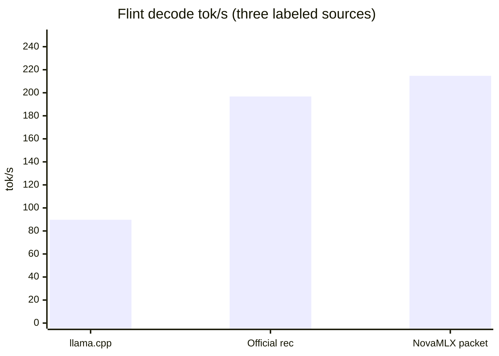

# Flint official INT4: packet width 16, LOOP 226.8 tok/s

> **Update (2026-10-26, v1.8.1).** MacMaxPro M4 Max, official `RecursiveSI/flint-int4`. Packet width **16** (#38, `ef57be1`): PARITY match 16, LOOP-RESULT **226.8 tok/s** (kernel packet), SINGLE-RESULT **190.7 tok/s**. FLINT-CHAT **217.3 tok/s** (#39, `313d92f`; `decodeTokens / wallDecodeSeconds`, packetTokens=128, singleTokens=0). The same run's LOOP-RESULT was **223.3 tok/s** (217.3 is below that run's kernel line; the gap versus 226.8 is run-to-run variance). The official rec **196.8** and llama.cpp ~**89.7** remain labeled comparisons and were not re-run. The table under What shipped is the 2026-10-25 / v1.8.0 record (packet=8, LOOP-RESULT 214.7). Catalog page: [Flint](../features/flint.md).

## Title

Flint official INT4: packet width 16, LOOP-RESULT 226.8 tok/s, FLINT-CHAT 217.3 tok/s

## One-line pitch

NovaMLX 1.8.1 on MacMaxPro M4 Max, `RecursiveSI/flint-int4`: packet width 16, kernel LOOP-RESULT 226.8 tok/s, FLINT-CHAT 217.3 tok/s (same run LOOP-RESULT 223.3). Recursive's Mac INT4 rec reference remains 196.8 tok/s (1K ctx / 256 tok, a different window). The 1.8.0 packet=8 record is 214.7.

## Who it is for / when to care

People who want to run Recursive Flint locally on a Mac (chain of thought, tool calls, 256K) and want the official INT4 rec decode number. When comparing the official rec 196.8 with the team's earlier llama.cpp reference, use the windows on this page and keep both as labeled comparisons. Do not describe the three sources as one run.

## What shipped (user-visible behavior)

Flint is still Recursive's 39.8B MoE (about 2.5B active): `<think>` goes to `reasoning_content`, GLM4-dialect tool calls are normalized to OpenAI `tool_calls`, and both the OpenAI and Anthropic APIs can stream the reply. The default weights are the official `RecursiveSI/flint-int4` (about 22.6 GB).

The 2026-10-25 speed merge is the rec megakernel, not another eager baseline:

- [PR #34](https://github.com/cnshsliu/novamlx/pull/34) (`cbc5fef`) connects official INT4 decode to the rec megakernel. Same-machine closed loop about **167.5 tok/s**.
- [PR #35](https://github.com/cnshsliu/novamlx/pull/35) (merge `e8e7b27`) reuses host/scratch, sets the M4 Max worker pool to launch=76/64/64, and adds a width-8 greedy resident packet. Before the packet was in, the same-machine closed loop was **185.2 tok/s**. `FlintSpeedTests` at the merge is in the table below.

The table is the 2026-10-25 / v1.8.0 record (`e8e7b27`, packet=8). Current numbers are at the top of the page.

Command for that record: `./build.sh test --filter FlintSpeedTests`. Machine MacMaxPro M4 Max, weights `RecursiveSI/flint-int4`. **PARITY:** match 16. **MEGA-SKIP:** MegaDecode is still gated, with no mega tok/s.

| Path | tok/s | Window | Source |
|------|------:|------|------|
| llama.cpp | ~89.7 | INT4-class Flint decode | Existing team reference. Not re-run this time |
| Official Recursive rec | 196.8 | Mac INT4 rec, 1K ctx / 256 tok decode | Official reference. Not a new Mac run this time, and not a NovaMLX result |
| NovaMLX single | 181.6 | one launch + host argmax, 128 rec steps | This run's SINGLE-RESULT, `e8e7b27` |
| NovaMLX packet | 214.7 | load→pack→decode, 128 rec steps, official=yes, launch=76/64/64, packet=8 | This run's LOOP-RESULT, `e8e7b27` |



The chart has three bars: llama.cpp **89.7**, Official rec **196.8**, NovaMLX packet **214.7**. Single-step 181.6 is not a bar.

The hero pair is NovaMLX’s measured packet loop at 214.7 tok/s against Recursive’s 196.8 tok/s reference. They are not the same harness: 128 rec steps versus 1K context / 256 decoded tokens.

## How to try it

Product path: download the official INT4, then start one temperature 0 chat. That is the chain of thought and the tool calls. Read chat throughput from FLINT-CHAT **217.3 tok/s** at the top of the page.

```bash
nova download RecursiveSI/flint-int4
curl -X POST localhost:6590/v1/chat/completions \
  -H "Authorization: Bearer $KEY" -H "Content-Type: application/json" \
  -d '{"model": "RecursiveSI/flint-int4",
       "messages": [{"role": "user", "content": "What is 17*23? Think step by step."}],
       "max_tokens": 500, "temperature": 0}'
```

For the speed numbers, use the suite and read `PARITY`, `SINGLE-RESULT`, `LOOP-RESULT`, and `MEGA-SKIP`:

```bash
./build.sh test --filter FlintSpeedTests
```

To reproduce the 2026-10-25 table, run that filter on a Mac with `RecursiveSI/flint-int4` present. After `LOOP-RESULT`, the same run prints `FLINT-CHAT`: 128 more packet tokens, `FlintRecResident.width` per launch, with one tokenizer decode per packet. Formula: `decodeTokens / wallDecodeSeconds` (prefill excluded). Compare that line with the same run's `LOOP-RESULT` (kernel packet only). The packet=8 record at `e8e7b27` is 214.7. v1.8.1 measured `FLINT-CHAT` at **217.3 tok/s** (same run LOOP-RESULT **223.3**); see the update at the top.

The chat curl is the product path. Temperature 0, one sequence, no logprobs, and frequency penalty 0 use the resident packet. When the reply finishes, `~/.nova/novamlx.log` has the same `FLINT-CHAT` line. The measured chat rate is 217.3 tok/s. 214.7 is the v1.8.0 packet=8 LOOP-RESULT.

## Limits / out of scope

- 214.7 is not the official blog's 196.8, and it is not llama.cpp's ~89.7. Neither of those was re-run this time. None of 214.7, 196.8, or ~89.7 is an HTTP end-to-end figure.
- 181.6 and 214.7 are the rec decode timing window in the 1.8.0 speed suite after shader compile. HTTP and the suite's chat window both read `FLINT-CHAT` (`decodeTokens / wallDecodeSeconds`, prefill excluded). v1.8.1 measured FLINT-CHAT at **217.3 tok/s**; see the top of the page.
- 214.7 is the greedy resident packet (argmax on device, packet=8). The same run's single-step path is one launch + host argmax (181.6). Sampling decode does not use the packet.
- The official reference window is 1K ctx / 256 tok decode. This NovaMLX run is 128 rec steps.
- MegaDecode was MEGA-SKIP this time, with no tok/s.
- 167.5 and 185.2 are earlier same-machine closed loops, not the `e8e7b27` LOOP-RESULT. 214.7 is the NovaMLX packet measurement. 196.8 is Recursive's reference. llama.cpp ~89.7 was not re-run. None of these is an HTTP end-to-end figure.

## Suggested video beats

Use the 1.8.1 numbers at the top of the page: width 16, LOOP-RESULT **226.8**, SINGLE-RESULT **190.7**, FLINT-CHAT **217.3** (same run LOOP-RESULT **223.3**). The beats below are the 1.8.0 / packet=8 shots.

- Flint is a local 40B agent model: chain of thought, tool calls, official INT4.
- Three bars: llama.cpp 89.7 (older reference, not re-run this time), official rec 196.8 (official reference, 1K/256), NovaMLX packet 214.7 (this LOOP-RESULT).
- Say it out loud: 214.7 is not the official blog number, and the windows differ (128 rec steps, packet=8, launch=76/64/64).
- The same run also has single-step 181.6 and PARITY match 16. The chat demo uses temperature 0. For throughput, read FLINT-CHAT **217.3** at the top of the page. 214.7 is the 1.8.0 packet=8 LOOP-RESULT.

## Links

- [Flint feature page](../features/flint.md)
- [PR #39](https://github.com/cnshsliu/novamlx/pull/39) (`313d92f`, FLINT-CHAT 217.3)
- [PR #38](https://github.com/cnshsliu/novamlx/pull/38) (`ef57be1`, packet width 16, LOOP-RESULT 226.8)
- [PR #35](https://github.com/cnshsliu/novamlx/pull/35) (`e8e7b27`)
- [PR #34](https://github.com/cnshsliu/novamlx/pull/34) (`cbc5fef`)
- [RecursiveSI/flint-int4](https://huggingface.co/RecursiveSI/flint-int4)
