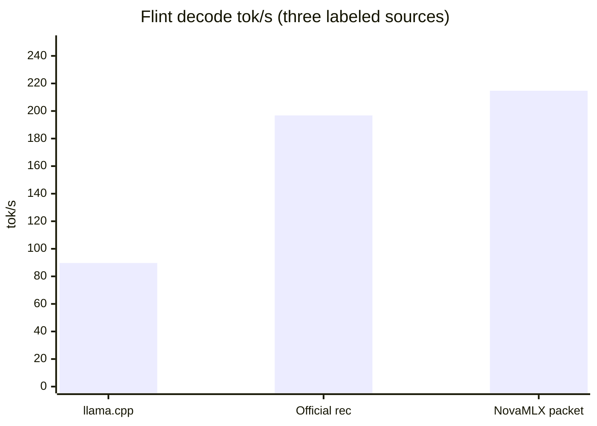

# Flint 官方 INT4：packet 宽度 16，LOOP 226.8 tok/s

> **Update (2026-10-26, v1.8.1).** MacMaxPro M4 Max，官方 `RecursiveSI/flint-int4`。Packet 宽度 **16**（#38，`ef57be1`）：PARITY match 16，LOOP-RESULT **226.8 tok/s**（kernel packet），SINGLE-RESULT **190.7 tok/s**。FLINT-CHAT **217.3 tok/s**（#39，`313d92f`；`decodeTokens / wallDecodeSeconds`，packetTokens=128，singleTokens=0）。同一轮 LOOP-RESULT **223.3 tok/s**（217.3 低于该轮 kernel；与 226.8 的差是跑间波动）。官方 rec **196.8** 与 llama.cpp ~**89.7** 仍是标明来源的对照，这次没有重跑。What shipped 里的表是 2026-10-25 / v1.8.0 的记录（packet=8，LOOP-RESULT 214.7）。目录页：[Flint](../features/flint.md)。

## Title

Flint 官方 INT4：packet 宽度 16，LOOP-RESULT 226.8 tok/s，FLINT-CHAT 217.3 tok/s

## One-line pitch

NovaMLX 1.8.1 on MacMaxPro M4 Max, `RecursiveSI/flint-int4`: packet width 16, LOOP-RESULT 226.8 tok/s (kernel), FLINT-CHAT 217.3 tok/s. Recursive's Mac INT4 rec reference remains 196.8 tok/s (1K ctx / 256 tok, a different window).

MacMaxPro M4 Max 上，packet 宽度 16 的 kernel LOOP-RESULT 是 **226.8 tok/s**，聊天口径 FLINT-CHAT 是 **217.3 tok/s**（同一轮 LOOP-RESULT **223.3**）。官方 Recursive Mac INT4 rec 参考仍是 **196.8 tok/s**。1.8.0 的 packet=8 记录是 214.7。

## Who it is for / when to care

要在 Mac 上本地跑 Recursive Flint（思考链、工具调用、256K），并想知道官方 INT4 的 rec 解码现在落到哪一档的人。拿官方 rec 的 196.8 和团队早先的 llama.cpp 参考做对照时，用这一页的口径，不要把三次来源说成同一次跑。

People running Flint locally on a Mac who want the official INT4 rec decode number, with the official 196.8 reference and the older llama.cpp reference kept as labeled comparisons.

## What shipped (user-visible behavior)

Flint 仍是 Recursive 的 39.8B MoE（约 2.5B 激活）：`<think>` 走 `reasoning_content`，GLM4 方言工具调用归一成 OpenAI `tool_calls`，OpenAI 与 Anthropic 接口都能流式返回。默认权重是官方 `RecursiveSI/flint-int4`（约 22.6 GB）。

2026-10-25 的速度合入是 rec megakernel，不是又一条 eager 基线：

- [PR #34](https://github.com/cnshsliu/novamlx/pull/34)（`cbc5fef`）把官方 INT4 解码接上 rec megakernel。同机闭环约 **167.5 tok/s**。
- [PR #35](https://github.com/cnshsliu/novamlx/pull/35)（合入点 `e8e7b27`）复用 host/scratch，M4 Max worker pool 为 launch=76/64/64，并加上宽度 8 的 greedy resident packet。packet 尚未进去时，同机闭环 **185.2 tok/s**。合入点上的 `FlintSpeedTests` 见下表。

下表是 2026-10-25 / v1.8.0（`e8e7b27`，packet=8）的记录。当前数字见页首。

本次命令：`./build.sh test --filter FlintSpeedTests`。机器 MacMaxPro M4 Max，权重 `RecursiveSI/flint-int4`。**PARITY:** match 16。**MEGA-SKIP:** MegaDecode 仍被门控，没有 mega tok/s。

| 路径 | tok/s | 口径 | 来源 |
|------|------:|------|------|
| llama.cpp | ~89.7 | INT4-class Flint decode | 团队既有参考。这次没有重跑 |
| Official Recursive rec | 196.8 | Mac INT4 rec，1K ctx / 256 tok decode | 官方参考。不是这次的 Mac 新跑，也不是 NovaMLX 的成绩 |
| NovaMLX single | 181.6 | 一次 launch + host argmax，128 rec steps | 本次 SINGLE-RESULT，`e8e7b27` |
| NovaMLX packet | 214.7 | load→pack→decode，128 rec steps，official=yes，launch=76/64/64，packet=8 | 本次 LOOP-RESULT，`e8e7b27` |



图上只有三条：llama.cpp **89.7**、Official rec **196.8**、NovaMLX packet **214.7**。单步 181.6 不在柱里。

The hero pair is NovaMLX’s measured packet loop at 214.7 tok/s against Recursive’s 196.8 tok/s reference. They are not the same harness: 128 rec steps versus 1K context / 256 decoded tokens.

## How to try it

产品路径：下载官方 INT4，再开一条 temperature 0 的对话。这是思考链和工具调用。聊天吞吐读页首的 FLINT-CHAT **217.3 tok/s**。

```bash
nova download RecursiveSI/flint-int4
curl -X POST localhost:6590/v1/chat/completions \
  -H "Authorization: Bearer $KEY" -H "Content-Type: application/json" \
  -d '{"model": "RecursiveSI/flint-int4",
       "messages": [{"role": "user", "content": "What is 17*23? Think step by step."}],
       "max_tokens": 500, "temperature": 0}'
```

速度数字用套件，看 `PARITY`、`SINGLE-RESULT`、`LOOP-RESULT`、`MEGA-SKIP`：

```bash
./build.sh test --filter FlintSpeedTests
```

To reproduce the 2026-10-25 table, run that filter on a Mac with `RecursiveSI/flint-int4` present. After `LOOP-RESULT`, the same run prints `FLINT-CHAT`: 128 more packet tokens, `FlintRecResident.width` per launch, with one tokenizer decode per packet. Formula: `decodeTokens / wallDecodeSeconds` (prefill excluded). Compare that line with the same run's `LOOP-RESULT` (kernel packet only). The packet=8 record at `e8e7b27` is 214.7. v1.8.1 measured `FLINT-CHAT` at **217.3 tok/s** (same run LOOP-RESULT **223.3**); see the update at the top.

The chat curl is the product path. Temperature 0, one sequence, no logprobs, and frequency penalty 0 use the resident packet. When the reply finishes, `~/.nova/novamlx.log` has the same `FLINT-CHAT` line. The measured chat rate is 217.3 tok/s. 214.7 is the v1.8.0 packet=8 LOOP-RESULT.

## Limits / out of scope

- 214.7 不是官方博客的 196.8，也不是 llama.cpp 的 ~89.7。后两个这次都没有重跑。
- 181.6 和 214.7 是 1.8.0 速度套件里 shader 编译完成之后的 rec decode 计时窗口。HTTP 和套件里的聊天口径都看 `FLINT-CHAT`（`decodeTokens / wallDecodeSeconds`，不含 prefill）。1.8.1 实测 FLINT-CHAT **217.3 tok/s**，见页首。
- 214.7 是 greedy resident packet（设备上 argmax，packet=8）。同一次的单步是一次 launch + host argmax（181.6）。采样解码不走 packet。
- 官方参考的窗口是 1K ctx / 256 tok decode；NovaMLX 这次是 128 rec steps。
- MegaDecode 这次是 MEGA-SKIP，没有 tok/s。
- 167.5 与 185.2 是同机更早提交的闭环，不是 `e8e7b27` 的 LOOP-RESULT。

214.7 is the NovaMLX packet measurement. 196.8 is Recursive’s reference. llama.cpp ~89.7 was not re-run. None of these is an HTTP end-to-end figure.

## Suggested video beats

当前数字用页首 1.8.1：宽度 16，LOOP-RESULT **226.8**，SINGLE-RESULT **190.7**，FLINT-CHAT **217.3**（同一轮 LOOP-RESULT **223.3**）。下面几条是 1.8.0 / packet=8 的拍法。

- Flint 是本地 40B agent 模型：思考链、工具调用、官方 INT4。
- 三根柱：llama.cpp 89.7（旧参考，这次没重跑）、官方 rec 196.8（官方参考，1K/256）、NovaMLX packet 214.7（这次 LOOP-RESULT）。
- 口头说清：214.7 不是官方博客数字；窗口也不相同（128 rec steps，packet=8，launch=76/64/64）。
- 同一次还有单步 181.6，以及 PARITY match 16。聊天演示走 temperature 0。吞吐念页首的 FLINT-CHAT **217.3**，214.7 是 1.8.0 的 packet=8 LOOP-RESULT。

## Links

- [Flint 功能页](../features/flint.md)
- [PR #39](https://github.com/cnshsliu/novamlx/pull/39)（`313d92f`，FLINT-CHAT 217.3）
- [PR #38](https://github.com/cnshsliu/novamlx/pull/38)（`ef57be1`，packet 宽度 16，LOOP-RESULT 226.8）
- [PR #35](https://github.com/cnshsliu/novamlx/pull/35)（`e8e7b27`）
- [PR #34](https://github.com/cnshsliu/novamlx/pull/34)（`cbc5fef`）
- [RecursiveSI/flint-int4](https://huggingface.co/RecursiveSI/flint-int4)
