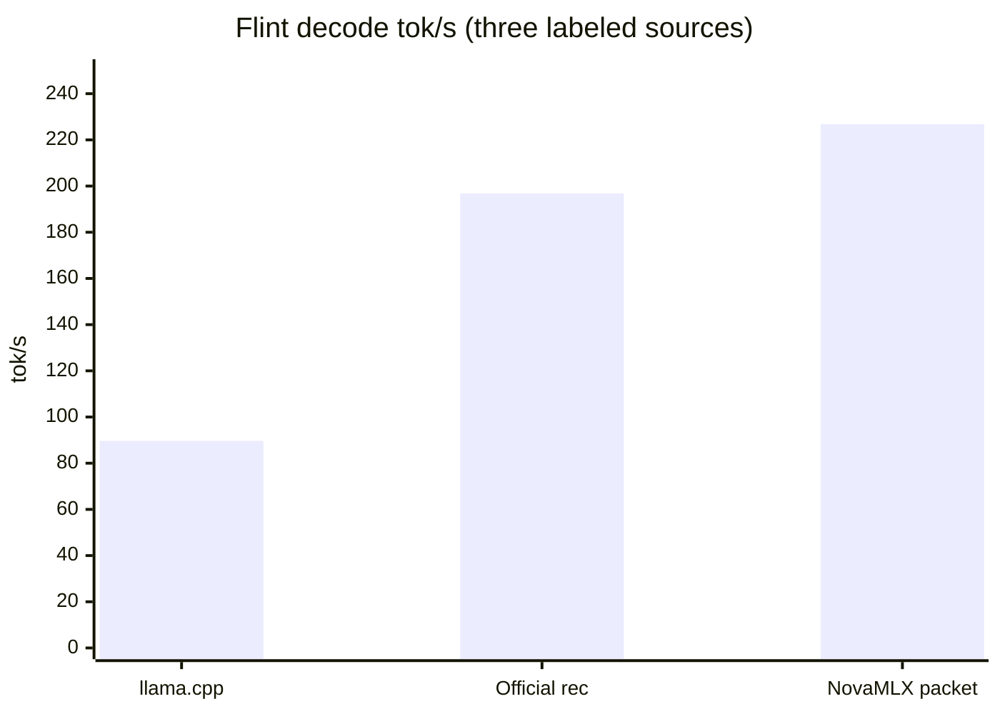

# Flint (Recursive)

**Pitch:** Recursive's 40B agent reasoning model — chain of thought, multi-turn tool calls, and a 256K context — running natively on local MLX.

Local inference for RecursiveSI Flint (39.8B MoE, ~2.5B active): a native Swift/MLX port (no Python). Token-identical to Python mlx-lm (greedy, same prompt, character-level match).

## Who it is for

People who want a local agent/coding model with reasoning and tool calls, and standard OpenAI and Anthropic APIs.

## What it does

| Feature | Details |
|---------|---------|
| **Architecture** | 49 layers: GQA (32q/4kv, head 128) + per-head QK RMSNorm + learned attention sinks; 35 sliding-window (513) + RoPE layers / 14 full-attention NoPE layers; sigmoid-routed MoE (6/256 experts + an ungated shared expert); the first 2 layers are dense |
| **Capabilities** | `<think>` reasoning (`reasoning_content` on its own channel), multi-turn tool calls (Flint `<tool_call>` / `<arg_key>` dialect, arguments typed from the tool schema, OpenAI `tool_calls` on the wire), 256K context (sliding-window KV) |
| **API** | OpenAI `/v1/chat/completions` + Anthropic `/v1/messages`, streaming and non-streaming; eos = `<|end_of_text|>` and role-header tokens (automatic stop and scrub, no leak) |
| **Decoding** | Flint chat uses the official rec flint structural grammar: one optional `<think>…</think>`, then answer or tool-call text whose logits mask forbids another think tag and the protocol markers. With that grammar on, the finish set is `grammar.stops`: `<|end_of_text|>`, `<|user|>`, and `<|observation|>`. `<|developer|>` is masked in the answer and is not a grammar stop. Grammar off (JSON schema, regex, GBNF, JSON mode, or `grammar: none`) keeps the checkpoint multi-EOS set, including `<|developer|>`. An omitted `max_tokens` fills the remaining context (`rec` `server.py`); an explicit value is only a cap. A custom `stop` while grammar is on is HTTP 400. The older think-reentry guard runs when grammar is off |
| **Scheduling** | Default HTTP chat goes through FusedBatchScheduler (including tool parsing). Structural grammar stays on, and the resident packet stays on with it: grammar, presence, and temperature / top-p / top-k are applied before each acceptance (`filtered`, width 16). Temperature 0 with no grammar and no presence still uses the device argmax packet, also width 16. `frequency_penalty != 0`, `min_p != 0`, a repetition penalty other than 0 or 1, and `stream` plus logprobs are HTTP 400. Non-stream logprobs and a second sequence stay on the single-step path |
| **Quantization** | Official `RecursiveSI/flint-int4` (~22.6 GB; the community OptiQ-4bit build was used for early verification and is no longer the default) |
| **Performance** | Official INT4 runs on the rec megakernel. MacMaxPro M4 Max, `RecursiveSI/flint-int4`, packet width 16: LOOP-RESULT **226.8 tok/s**, SINGLE-RESULT **190.7 tok/s**, FLINT-CHAT **217.3 tok/s**. Window, comparisons, and the bar chart are in [Speed](#speed). |

## How to try

```bash
nova download RecursiveSI/flint-int4
# After load, select it on the Local Inference page, or:
curl -X POST localhost:6590/v1/chat/completions \
  -H "Authorization: Bearer $KEY" -H "Content-Type: application/json" \
  -d '{"model": "RecursiveSI/flint-int4",
       "messages": [{"role": "user", "content": "What is 17*23? Think step by step."}],
       "max_tokens": 500, "temperature": 0}'
# → reasoning_content (step-by-step reasoning) + content (the answer), two channels
```

Recommended sampling: temperature 1.0, top-p 0.95, top-k 20. Those are the official `rec` `Sampling` defaults, and Nova applies them for Flint when `generation_config.json` omits the field. A value in that file still wins. Use temperature 0 for an exact reproduction.

## Speed

The tok/s figures below are the ones listed for this measurement, plus comparisons whose source is named. Numbers from other runs are not added to the table.

This NovaMLX measurement: MacMaxPro M4 Max, official weights `RecursiveSI/flint-int4`, `./build.sh test --filter FlintSpeedTests`. #38 merge `ef57be1` (packet width 16); #39 merge `313d92f` (FLINT-CHAT).

- **PARITY:** match 16 (the next 16 greedy tokens from single-step host argmax match the resident packet). #38 and #39 are both match 16.
- **SINGLE-RESULT:** one launch + host argmax, **190.7 tok/s** (#38, packet width 16)
- **LOOP-RESULT:** load→pack→decode, **226.8 tok/s** (kernel packet, width 16, #38 / `ef57be1`). On the run that printed FLINT-CHAT (#39), LOOP-RESULT was **223.3 tok/s** (the gap versus 226.8 is run-to-run variance).
- **FLINT-CHAT:** **217.3 tok/s** (#39 / `313d92f`). Formula `decodeTokens / wallDecodeSeconds`, packetTokens=128, singleTokens=0. Below the same run's LOOP-RESULT **223.3**.

| Path | tok/s | Window | Source |
|------|------:|------|------|
| llama.cpp | ~89.7 | INT4-class Flint decode | Existing team reference. Not re-run for this measurement |
| Official Recursive rec | 196.8 | Mac INT4 rec, 1K ctx / 256 tok decode | Official reference. NovaMLX is compared against it. Not a new Mac run this time, and not a NovaMLX result |
| NovaMLX single | 190.7 | one launch + host argmax, packet width 16 | SINGLE-RESULT, #38 / `ef57be1` |
| NovaMLX packet | 226.8 | kernel packet, load→pack→decode, width 16 | LOOP-RESULT, #38 / `ef57be1` |
| NovaMLX FLINT-CHAT | 217.3 | `decodeTokens / wallDecodeSeconds`, packetTokens=128, singleTokens=0 | #39 / `313d92f`. Same run's LOOP-RESULT 223.3 |

Three comparisons go on the bar chart: llama.cpp, the official rec, and NovaMLX packet (#38 kernel **226.8**). Single-step 190.7 and FLINT-CHAT 217.3 stay in the table. FLINT-CHAT 217.3 is compared with the same run's LOOP-RESULT **223.3**.



Bar heights are **89.7**, **196.8**, and **226.8**. 226.8 is this NovaMLX kernel packet closed loop (width 16). The official **196.8** window is 1K ctx / 256 tok decode; this NovaMLX LOOP is a width-16 kernel packet. The two columns are labeled-source comparisons. The axis stays 0–250, so 226.8 is on the scale.

Same machine, earlier commits (not the row in the table above):

- PR #34 merge `cbc5fef`: closed loop ~167.5 tok/s
- In #35, after host/scratch and the 76 pool landed and before the packet was in: 185.2 tok/s
- 1.8.0 / `e8e7b27`: packet=8, LOOP-RESULT **214.7 tok/s** (128 rec steps, official=yes, launch=76/64/64), SINGLE-RESULT **181.6 tok/s**. MegaDecode was MEGA-SKIP, with no mega tok/s

190.7 and 226.8 are both the rec decode timing window inside `FlintSpeedTests` after shader compile, not HTTP end-to-end. 226.8 is the greedy resident packet (argmax on device, width 16). The same run's single-step path is one launch and host argmax (190.7). Grammar and recommended sampling (temperature 1.0, top-p 0.95, top-k 20) use the filtered packet at the same width 16. That path is not a new tok/s measurement; the 226.8 figure stays the greedy device packet.

### Chat tok/s (`FLINT-CHAT`)

The end-to-end decode rate is **`decodeTokens / wallDecodeSeconds`**.

- `decodeTokens`: tokens emitted by decode steps after the first token sampled from prefill. EOS is not counted.
- `wallDecodeSeconds`: from before the first decode launch until those tokens have been detokenized and checked for a stop. Weight load is excluded. Prefill is excluded. The same line on the serial iterator stops at the last token id; the engine turns the id into text after `next()`.
- Measured: **217.3 tok/s** (#39 / `313d92f`, MacMaxPro M4 Max, `RecursiveSI/flint-int4`, packetTokens=128, singleTokens=0). The comparison is the same run's `FlintSpeedTests` `LOOP-RESULT` **223.3 tok/s** (kernel packet only, no tokenizer, width 16). 217.3 is below that run's kernel number. Another kernel LOOP-RESULT from #38 (`ef57be1`) is **226.8 tok/s**; 223.3 versus 226.8 is run-to-run variance. The packet=8 record at `e8e7b27`, **214.7 tok/s**, is the earlier width.

On a Mac, start with the speed suite. The `LOOP-RESULT` timing window is unchanged. After it prints, another line, `FLINT-CHAT`, runs 128 more packet tokens with one `tokenizer.decode` per packet (`FlintRecResident.width`):

```bash
./build.sh test --filter FlintSpeedTests
```

HTTP chat (official INT4) writes the same line to `~/.nova/novamlx.log` when the sequence finishes. Default Flint chat has the structural grammar on and samples with `generation_config.json` (temperature 1.0, top-p 0.95, top-k 20) unless the request overrides them. That combination uses the filtered resident packet, so `packetTokens` counts those steps. `singleTokens` is the handoff before the rec session is live, plus any request the packet refuses.

### Packet allow / reject

Official `rec` keeps resident decode under grammar and under recommended sampling via `FilteredResidentSampler` (width 8). Nova keeps width **16**.

| Request | Official `rec` | Nova Flint |
|---|---|---|
| Temperature 0, no structural grammar, presence 0, frequency 0, repetition neutral, no logprobs, one sequence | Fused greedy kernel, width 8 | Device argmax packet, width 16 |
| Structural grammar, and/or presence penalty, and/or temperature / top-p / top-k | `FilteredResidentSampler`, width 8 | Filtered packet, width 16. Grammar mask and presence run before the sampler. Top-k masks logits, then the fused sampler applies temperature and top-p |
| Temperature 1, top-p 1, top-k 0, no grammar or presence | Fused gumbel kernel, width 8 | Filtered packet (host sampler, no gumbel kernel) |
| `frequency_penalty != 0` | HTTP 400 | HTTP 400, `Nonzero frequency_penalty is not supported by this decoder` |
| Repetition penalty other than 0 or 1 | HTTP 400 | HTTP 400, `Only neutral repetition_penalty=1 is supported`. 0 and 1 stay on the packet |
| `min_p != 0` | HTTP 400 | HTTP 400, `Nonzero min_p is not supported by this decoder` |
| `stream: true` and logprobs | HTTP 400 | HTTP 400, `Token logprobs require stream=false` |
| Non-stream logprobs | Filtered packet | Single-step, so each token keeps its logprobs |
| Two sequences at once | Single session only | Single-step |
| JSON schema, regex, or GBNF | Not the flint grammar | Single-step on the serial iterator, which applies that mask. Fused decode does not apply those masks; a greedy request there still uses the device packet |

A filtered step refuses a token the grammar mask forbids (a second `<think>`, token 150006, after the answer has started). With structural grammar on, the finish set is the three grammar stops: `<|end_of_text|>`, `<|user|>`, and `<|observation|>`. `<|developer|>` is masked during the answer and is not one of those stops. Grammar off keeps `<|developer|>` in the checkpoint multi-EOS set. The mask is checked before the stop set, so a masked id is not accepted as a finish token.

```bash
curl -X POST localhost:6590/v1/chat/completions \
  -H "Authorization: Bearer $KEY" -H "Content-Type: application/json" \
  -d '{"model": "RecursiveSI/flint-int4",
       "messages": [{"role": "user", "content": "What is 17*23? Think step by step."}],
       "max_tokens": 500, "temperature": 0}'
# Search ~/.nova/novamlx.log for FLINT-CHAT
```

## Limits / notes

- With `thinking_budget` omitted, Flint stops on `max_tokens` (and the usual eos / role-header stops). Pass `thinking_budget` to opt into a close-marker cap. Other thinking families still receive an automatic cap when the field is omitted.
- An omitted `max_tokens` on Flint fills `context window − prompt`, matching `rec` `server.py` `handle_completion`. There is no second cap at 1024 or 2048. An explicit `max_tokens`, including one saved on the model and `/demo/chat`'s 2048, stays as sent. The memory preflight still applies to that budget and can refuse a full-window reservation. Other families keep the ModelConfig default (2048) when the field is omitted.
- A custom `stop` while Flint structural grammar is on is rejected (`Flint grammar cannot be combined with custom stop strings`, HTTP 400), the same sentence as `rec`. Grammar stays off for JSON schema, regex, GBNF, and JSON mode, and a custom stop is allowed there; `ThinkReentryGuard` covers those requests. An empty stop list is not a custom stop.
- Before the chat template, Flint user, system, and tool text drops NUL and `<think>` tags and escapes role markers (`<|user|>` and the other headers), matching `rec` `normalize_messages`. Assistant text is left alone. History tool-call arguments must be a JSON object; blank becomes `{}`.
- Default Flint chat installs the structural grammar and the filtered resident packet (width 16). A second `<think>` is masked before that packet accepts a token.
- Load pins the official `rec` `chat_template.jinja` (`chat_template_sha256=44fd1b0f94b78d9cf554c5a207945e48fef698b279d65863a33a77d787ca411b`). The package file overwrites the checkpoint `chat_template`, and a live `chat_template.jinja` is quarantined because swift-transformers prefers that file. The hash is SHA-256 of the template UTF-8 bytes, the same algorithm as `hashlib.sha256(template.encode()).hexdigest()`.
- Fused Flint tool calls follow `rec` `parse_tool_call`: string schema values stay raw, other values are JSON. An omitted seed is 0, matching `Sampling.seed`. An explicit request seed wins over the model config. Sampling (`MLXRandom.seed`) and call ids (`seeded_tool_parser`) share that seed, so a request with no seed replays the seed-0 UUIDs. Session, JSON, regex, and GBNF turns still use the stock parser.
- `enforce_tool_schemas` (request field, `NOVA_ENFORCE_TOOL_SCHEMAS`, or server config) is off by default. Tool names are constrained whenever tools are present. Argument schemas are enforced when the flag is on or `strict` is not `false`: omitted `strict` enforces, and `strict: false` stays false on the client tool and is still enforced when the flag is on. With the flag off, a `strict: false` body stays loose after the name is accepted. The host FSM matches `build_flint_glm_grammar` / xgrammar `glm_4_7` (`any_order=False`): `pattern`, `format` (date, time, date-time, uuid, email, uri), string length, numeric bounds, nested object properties, and schema key order. Optional keys may be skipped. A required key cannot be skipped, and a later key cannot precede an earlier one. Every tool needs a function name and an object `parameters` schema (`Flint grammar requires a function name`, `Flint grammar requires object parameter schemas`), including when the flag is off. `grammar: none` skips that check. Other families ignore the flag.
- Flint `tool_choice` is `auto` or `none` (`tool_choice currently supports auto and none; forced calls are not implemented`). `none` drops tools. `parallel_tool_calls=false` is HTTP 400. `store` other than `false` is HTTP 400 (`Stored-completion retrieval is not supported; use store=false`). `grammar` is `none` or `flint`.
- Between Flint turns, `select_prefix` reuses the token-level common prefix and the prefill KV snapshot. The log line is `Prefill: prompt=… common_prefix=… reused=… new=…`. `cached_prompt_tokens` is the reused length (`usage.prompt_tokens_details.cached_tokens`). `common_prefix_tokens` is the raw match, which can be longer than the reused length when a checkpoint rewinds. A trimmable snapshot extends reuse up to the common prefix, so two chats that share a system and tool prefix report `cached_prompt_tokens > 0`. `prepare_prefix` runs after a generation of at least one prefill chunk (65536 tokens) and does not replace the anchor if a chunk is cancelled. This is not `NovaMLXPrefixCache`: that store is a block-hash SSD cache, and Flint does not use it for this protocol.
- A packet whose new text contains `<` (a tool marker, a think tag, or half a tag) is still decoded token by token. A greedy packet with no `<` is decoded once, then handed to the parser.
- Text-to-3D and similar paths are separate from Flint. Flint is a text agent model.
- TurboQuant KV cache drops attention sinks (the same tradeoff as GPT-OSS) and is off by default.
- 190.7 / 226.8 in [Speed](#speed) are `FlintSpeedTests` rec decode. FLINT-CHAT **217.3** is the chat decode window, below the same run's LOOP-RESULT **223.3**. The official 196.8 and llama.cpp ~89.7 are labeled-source comparisons, not a re-run this time. 1.8.0's 181.6 / 214.7 (packet=8) is the earlier record.

## Related

- [API compatibility](api-compatibility.md)
- [Tool calling](tool-calling.md)
- [Feature brief](../feature-briefs/2026-10-25-flint.md)
- `FlintModel.swift`, `FlintProcessor.swift` (`NovaMLXEngine`)
