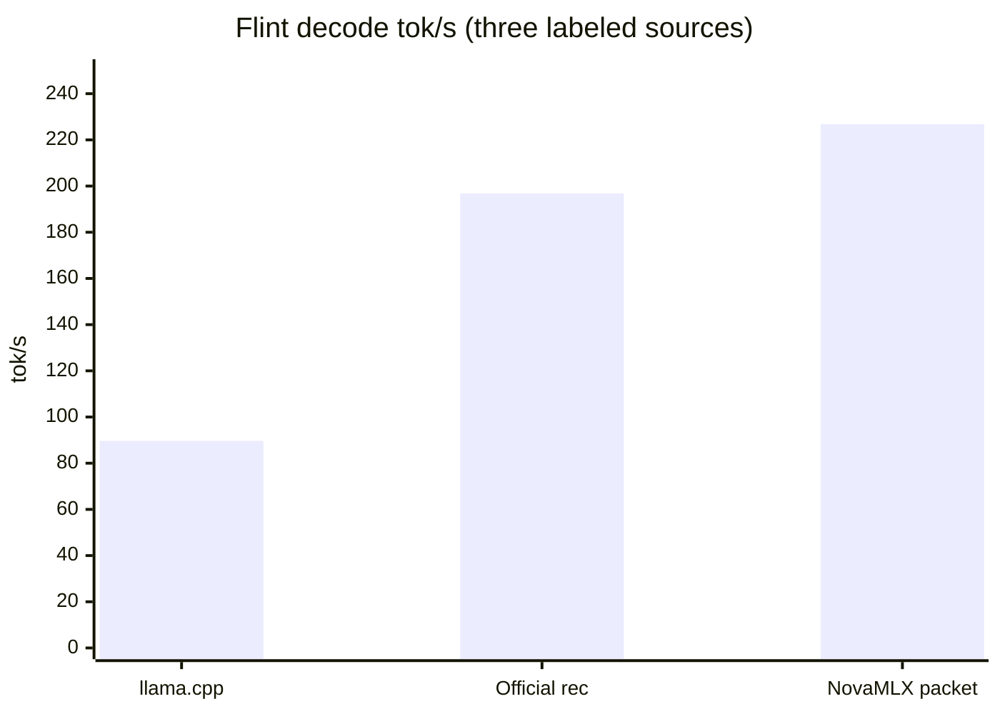

# Flint (Recursive)

**Pitch:** Recursive's 40B agent reasoning model — chain of thought, multi-turn tool calls, and a 256K context — running natively on local MLX.

Local inference for RecursiveSI Flint (39.8B MoE, ~2.5B active): a native Swift/MLX port (no Python). Token-identical to Python mlx-lm (greedy, same prompt, character-level match).

## Who it is for

People who want a local agent/coding model with reasoning and tool calls, and standard OpenAI and Anthropic APIs.

## What it does

| Feature | Details |
|---------|---------|
| **Architecture** | 49 layers: GQA (32q/4kv, head 128) + per-head QK RMSNorm + learned attention sinks; 35 sliding-window (513) + RoPE layers / 14 full-attention NoPE layers; sigmoid-routed MoE (6/256 experts + an ungated shared expert); the first 2 layers are dense |
| **Capabilities** | `<think>` reasoning (`reasoning_content` on its own channel), multi-turn tool calls (GLM4 dialect normalized to standard OpenAI tool_calls), 256K context (sliding-window KV) |
| **API** | OpenAI `/v1/chat/completions` + Anthropic `/v1/messages`, streaming and non-streaming; eos = `<|end_of_text|>` and role-header tokens (automatic stop and scrub, no leak) |
| **Scheduling** | Default HTTP chat goes through FusedBatchScheduler (including tool parsing). Temperature 0, one sequence, no logprobs, no frequency penalty, and no grammar use the resident packet. Session, grammar, and sampling stay on the single-step path |
| **Quantization** | Official `RecursiveSI/flint-int4` (~22.6 GB; the community OptiQ-4bit build was used for early verification and is no longer the default) |
| **Performance** | Official INT4 runs on the rec megakernel. MacMaxPro M4 Max, `RecursiveSI/flint-int4`, packet width 16: LOOP-RESULT **226.8 tok/s**, SINGLE-RESULT **190.7 tok/s**, FLINT-CHAT **217.3 tok/s**. Window, comparisons, and the bar chart are in [Speed](#speed). |

## How to try

```bash
nova download RecursiveSI/flint-int4
# After load, select it on the Local Inference page, or:
curl -X POST localhost:6590/v1/chat/completions \
  -H "Authorization: Bearer $KEY" -H "Content-Type: application/json" \
  -d '{"model": "RecursiveSI/flint-int4",
       "messages": [{"role": "user", "content": "What is 17*23? Think step by step."}],
       "max_tokens": 500, "temperature": 0}'
# → reasoning_content (step-by-step reasoning) + content (the answer), two channels
```

Recommended sampling: temperature 1.0, top-p 0.95, top-k 20 (the official recommendation). Use temperature 0 for an exact reproduction.

## Speed

The tok/s figures below are the ones listed for this measurement, plus comparisons whose source is named. Numbers from other runs are not added to the table.

This NovaMLX measurement: MacMaxPro M4 Max, official weights `RecursiveSI/flint-int4`, `./build.sh test --filter FlintSpeedTests`. #38 merge `ef57be1` (packet width 16); #39 merge `313d92f` (FLINT-CHAT).

- **PARITY:** match 16 (the next 16 greedy tokens from single-step host argmax match the resident packet). #38 and #39 are both match 16.
- **SINGLE-RESULT:** one launch + host argmax, **190.7 tok/s** (#38, packet width 16)
- **LOOP-RESULT:** load→pack→decode, **226.8 tok/s** (kernel packet, width 16, #38 / `ef57be1`). On the run that printed FLINT-CHAT (#39), LOOP-RESULT was **223.3 tok/s** (the gap versus 226.8 is run-to-run variance).
- **FLINT-CHAT:** **217.3 tok/s** (#39 / `313d92f`). Formula `decodeTokens / wallDecodeSeconds`, packetTokens=128, singleTokens=0. Below the same run's LOOP-RESULT **223.3**.

| Path | tok/s | Window | Source |
|------|------:|------|------|
| llama.cpp | ~89.7 | INT4-class Flint decode | Existing team reference. Not re-run for this measurement |
| Official Recursive rec | 196.8 | Mac INT4 rec, 1K ctx / 256 tok decode | Official reference. NovaMLX is compared against it. Not a new Mac run this time, and not a NovaMLX result |
| NovaMLX single | 190.7 | one launch + host argmax, packet width 16 | SINGLE-RESULT, #38 / `ef57be1` |
| NovaMLX packet | 226.8 | kernel packet, load→pack→decode, width 16 | LOOP-RESULT, #38 / `ef57be1` |
| NovaMLX FLINT-CHAT | 217.3 | `decodeTokens / wallDecodeSeconds`, packetTokens=128, singleTokens=0 | #39 / `313d92f`. Same run's LOOP-RESULT 223.3 |

Three comparisons go on the bar chart: llama.cpp, the official rec, and NovaMLX packet (#38 kernel **226.8**). Single-step 190.7 and FLINT-CHAT 217.3 stay in the table. FLINT-CHAT 217.3 is compared with the same run's LOOP-RESULT **223.3**.



Bar heights are **89.7**, **196.8**, and **226.8**. 226.8 is this NovaMLX kernel packet closed loop (width 16). The official **196.8** window is 1K ctx / 256 tok decode; this NovaMLX LOOP is a width-16 kernel packet. The two columns are labeled-source comparisons. The axis stays 0–250, so 226.8 is on the scale.

Same machine, earlier commits (not the row in the table above):

- PR #34 merge `cbc5fef`: closed loop ~167.5 tok/s
- In #35, after host/scratch and the 76 pool landed and before the packet was in: 185.2 tok/s
- 1.8.0 / `e8e7b27`: packet=8, LOOP-RESULT **214.7 tok/s** (128 rec steps, official=yes, launch=76/64/64), SINGLE-RESULT **181.6 tok/s**. MegaDecode was MEGA-SKIP, with no mega tok/s

190.7 and 226.8 are both the rec decode timing window inside `FlintSpeedTests` after shader compile, not HTTP end-to-end. 226.8 is the greedy resident packet (argmax on device, width 16). The same run's single-step path is one launch and host argmax (190.7). Sampling decode does not use the packet.

### Chat tok/s (`FLINT-CHAT`)

The end-to-end decode rate is **`decodeTokens / wallDecodeSeconds`**.

- `decodeTokens`: tokens emitted by decode steps after the first token sampled from prefill. EOS is not counted.
- `wallDecodeSeconds`: from before the first decode launch until those tokens have been detokenized and checked for a stop. Weight load is excluded. Prefill is excluded. The same line on the serial iterator stops at the last token id; the engine turns the id into text after `next()`.
- Measured: **217.3 tok/s** (#39 / `313d92f`, MacMaxPro M4 Max, `RecursiveSI/flint-int4`, packetTokens=128, singleTokens=0). The comparison is the same run's `FlintSpeedTests` `LOOP-RESULT` **223.3 tok/s** (kernel packet only, no tokenizer, width 16). 217.3 is below that run's kernel number. Another kernel LOOP-RESULT from #38 (`ef57be1`) is **226.8 tok/s**; 223.3 versus 226.8 is run-to-run variance. The packet=8 record at `e8e7b27`, **214.7 tok/s**, is the earlier width.

On a Mac, start with the speed suite. The `LOOP-RESULT` timing window is unchanged. After it prints, another line, `FLINT-CHAT`, runs 128 more packet tokens with one `tokenizer.decode` per packet (`FlintRecResident.width`):

```bash
./build.sh test --filter FlintSpeedTests
```

HTTP chat (official INT4, temperature 0, one sequence, no logprobs, `frequency_penalty` 0) writes the same line to `~/.nova/novamlx.log` when the sequence finishes. `packetTokens` should be most of the decode tokens; the 1–2 tokens before the rec session is established are counted in `singleTokens`. Temperature > 0, logprobs, frequency penalty, grammar, session, and a second concurrent sequence stay on the single-step path.

```bash
curl -X POST localhost:6590/v1/chat/completions \
  -H "Authorization: Bearer $KEY" -H "Content-Type: application/json" \
  -d '{"model": "RecursiveSI/flint-int4",
       "messages": [{"role": "user", "content": "What is 17*23? Think step by step."}],
       "max_tokens": 500, "temperature": 0}'
# Search ~/.nova/novamlx.log for FLINT-CHAT
```

## Limits / notes

- Tool calls are parsed on the fused path. Flint always has the GLM4 parser attached. A packet whose new text contains `<` (a tool marker, a think tag, or half a tag) is still decoded token by token. A greedy packet with no `<` is decoded once, then handed to the same parser.
- Text-to-3D and similar paths are separate from Flint. Flint is a text agent model.
- TurboQuant KV cache drops attention sinks (the same tradeoff as GPT-OSS) and is off by default.
- 190.7 / 226.8 in [Speed](#speed) are `FlintSpeedTests` rec decode. FLINT-CHAT **217.3** is the chat decode window, below the same run's LOOP-RESULT **223.3**. The official 196.8 and llama.cpp ~89.7 are labeled-source comparisons, not a re-run this time. 1.8.0's 181.6 / 214.7 (packet=8) is the earlier record.

## Related

- [API compatibility](api-compatibility.md)
- [Tool calling](tool-calling.md)
- [Feature brief](../feature-briefs/2026-10-25-flint.md)
- `FlintModel.swift`, `FlintProcessor.swift` (`NovaMLXEngine`)
