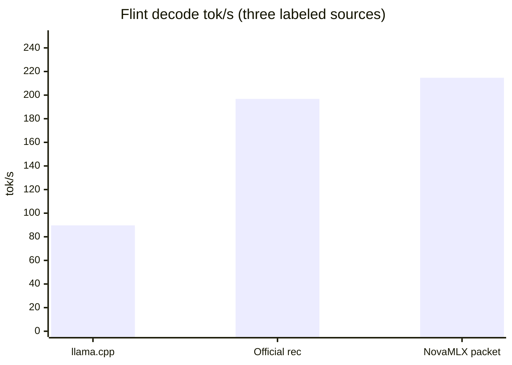

# Flint（Recursive）

**Pitch:** Recursive 的 40B agent 推理模型——思考链、多轮工具调用、256K 上下文，原生跑在本地 MLX 上。

本地推理 RecursiveSI Flint（39.8B MoE，~2.5B 激活），Swift/MLX 原生移植（无 Python）。与 Python mlx-lm **逐 token 对齐**（greedy 同题字符级一致）。

## Who it is for

要在本地跑带推理和工具调用的 agent/coding 模型、且要求 OpenAI/Anthropic 双协议标准接口的人。

## What it does

| Feature | Details |
|---------|---------|
| **架构** | 49 层：GQA（32q/4kv，head 128）+ per-head QK RMSNorm + learned attention sinks；35 层滑窗(513)+RoPE / 14 层全注意力 NoPE；sigmoid 路由 MoE（6/256 专家 + 无门控共享专家），前 2 层 dense |
| **能力** | `<think>` 推理（`reasoning_content` 独立通道）、多轮工具调用（GLM4 方言自动归一为标准 OpenAI tool_calls）、256K 上下文（滑窗 KV） |
| **API** | OpenAI `/v1/chat/completions` + Anthropic `/v1/messages`，流式/非流式；eos = `<|end_of_text|>` 及角色头 token（自动停止+清洗，不泄漏） |
| **调度** | 默认 HTTP 聊天走 FusedBatchScheduler（含工具解析）。temperature 0、单序列、无 logprobs、无 frequency penalty、无 grammar 时走 resident packet。session / grammar / 采样仍走单步 |
| **量化** | 官方 `RecursiveSI/flint-int4`（~22.6 GB；社区 OptiQ-4bit 曾用于早期验证，现已弃用为默认） |
| **性能参考** | 官方 INT4 走 rec megakernel。MacMaxPro M4 Max，`e8e7b27`，`FlintSpeedTests`：单步 **181.6 tok/s**；packet=8 闭环 **214.7 tok/s**。口径、对照和柱状图见 [Speed](#speed)。 |

## How to try

```bash
nova download RecursiveSI/flint-int4
# 加载后在 Local Inference 页选择，或：
curl -X POST localhost:6590/v1/chat/completions \
  -H "Authorization: Bearer $KEY" -H "Content-Type: application/json" \
  -d '{"model": "RecursiveSI/flint-int4",
       "messages": [{"role": "user", "content": "What is 17*23? Think step by step."}],
       "max_tokens": 500, "temperature": 0}'
# → reasoning_content（分步推理）+ content（答案）双通道
```

推荐采样：temperature 1.0、top-p 0.95、top-k 20（官方推荐）；精确复现用 temperature 0。

## Speed

下面只写这次列出的 tok/s，以及标明来源的对照。没有另跑的数不进表。

本次 NovaMLX 测量：MacMaxPro M4 Max，权重 `RecursiveSI/flint-int4`，`./build.sh test --filter FlintSpeedTests`，PR #35 合入点 `e8e7b27`。

- **PARITY:** match 16（单步 host argmax 与 resident packet 接下来的 16 个 greedy token 一致）
- **SINGLE-RESULT:** 一次 launch + host argmax，**181.6 tok/s**（128 rec steps）
- **LOOP-RESULT:** load→pack→decode，**214.7 tok/s**（128 rec steps，official=yes，launch=76/64/64，packet=8）
- **MEGA-SKIP:** MegaDecode 仍被门控，这次没有 mega 的 tok/s

| 路径 | tok/s | 口径 | 来源 |
|------|------:|------|------|
| llama.cpp | ~89.7 | INT4-class Flint decode | 团队既有参考。这次测量没有重跑 |
| Official Recursive rec | 196.8 | Mac INT4 rec，1K ctx / 256 tok decode | 官方参考，NovaMLX 对标它。不是这次的 Mac 新跑，也不是 NovaMLX 的成绩 |
| NovaMLX single | 181.6 | 一次 launch + host argmax，128 rec steps | 本次 SINGLE-RESULT，`e8e7b27` |
| NovaMLX packet | 214.7 | load→pack→decode，128 rec steps，packet=8 | 本次 LOOP-RESULT，`e8e7b27` |

三条对照：llama.cpp、官方 rec、NovaMLX packet。单步 181.6 只在表里。



柱高是 **89.7**、**196.8**、**214.7**。214.7 是 NovaMLX 这次的 packet 闭环，不是官方博客上的数字。官方 **196.8** 的窗口是 1K ctx / 256 tok decode；NovaMLX 这次是 128 rec steps。两列不是同一套 bench 的复跑。

同机、更早的提交（不是上表这一行）：

- PR #34 合入点 `cbc5fef`：闭环 ~167.5 tok/s
- #35 里 host/scratch 与 76 pool 先落地、packet 尚未进去时：185.2 tok/s

181.6 和 214.7 都是 `FlintSpeedTests` 里 shader 编译完成之后的 rec decode 计时窗口，不是 HTTP 端到端。214.7 是 greedy resident packet（argmax 在设备上，packet=8）。同一次跑的单步路径是一次 launch、host argmax。采样解码不走 packet。

### Chat tok/s（`FLINT-CHAT`）

端到端 decode 速率的公式是 **`decodeTokens / wallDecodeSeconds`**。

- `decodeTokens`：prefill 采样出的第一个 token 之后，decode 步发出的 token。EOS 不计入。
- `wallDecodeSeconds`：从第一次 decode launch 之前开始，到这些 token 做完 detokenize 和停止检查。不含权重加载，不含 prefill。串行迭代器的同一行停在最后一个 token id；引擎在 `next()` 之后才把 id 解成文本。
- 对照是同一轮 `FlintSpeedTests` 打出来的 `LOOP-RESULT`（kernel packet only，无 tokenizer，宽度 `FlintRecResident.width`，#38 之后是 16）。`e8e7b27` 的 packet=8 记录仍是 **214.7 tok/s**。`FLINT-CHAT` 含 tokenizer，所以会低于同一轮的 `LOOP-RESULT`。这次没有新的实测聊天数字，不要把 214.7 或 `LOOP-RESULT` 抄成 `FLINT-CHAT`。

Mac 上先看速度套件。`LOOP-RESULT` 的计时窗口不变；它打印完之后另有一行 `FLINT-CHAT`，是再跑 128 个 packet token、每个 packet（`FlintRecResident.width`）一次 `tokenizer.decode`：

```bash
./build.sh test --filter FlintSpeedTests
```

HTTP 聊天（官方 INT4，temperature 0，一条序列，不要 logprobs，`frequency_penalty` 为 0）在序列结束时把同一行写到 `~/.nova/novamlx.log`。`packetTokens` 应占 decode tokens 的大部分；rec session 建立前的 1–2 个 token 记在 `singleTokens`。temperature > 0、logprobs、frequency penalty、grammar、session、第二条并发序列留在单步。

```bash
curl -X POST localhost:6590/v1/chat/completions \
  -H "Authorization: Bearer $KEY" -H "Content-Type: application/json" \
  -d '{"model": "RecursiveSI/flint-int4",
       "messages": [{"role": "user", "content": "What is 17*23? Think step by step."}],
       "max_tokens": 500, "temperature": 0}'
# ~/.nova/novamlx.log 里搜 FLINT-CHAT
```

## Limits / notes

- 工具调用在 fused 路径上解析。Flint 始终挂着 GLM4 解析器。新文本里出现 `<`（工具标记、think 标签，或半个标签）的 packet 仍逐 token 解码；没有 `<` 的 greedy packet 一次 decode，再交给同一个解析器。
- 纯 text-to-3D 之类与 Flint 无关；Flint 是文本 agent 模型。
- TurboQuant KV 缓存会丢弃 attention sinks（与 GPT-OSS 相同的取舍），默认不启用。
- [Speed](#speed) 里的 181.6 / 214.7 是 `FlintSpeedTests` 的 rec decode。官方 196.8 与 llama.cpp ~89.7 是标明来源的对照，不是这次重跑。`FLINT-CHAT` 才是聊天 decode 口径，和 214.7 比的时候要分开读。

## Related

- [API 兼容 / API compatibility](api-compatibility.md)
- [工具调用 / Tool calling](tool-calling.md)
- [功能简报 / Feature brief](../feature-briefs/2026-10-25-flint.md)
- `FlintModel.swift`、`FlintProcessor.swift`（`NovaMLXEngine`）
